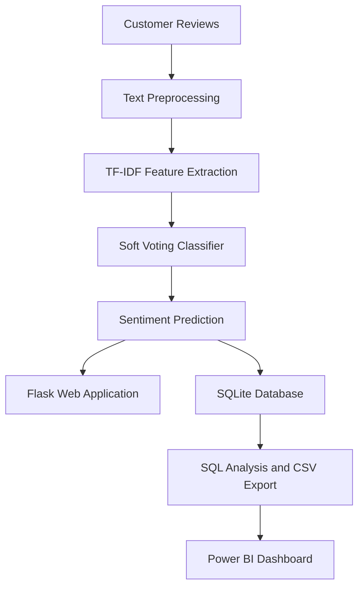

# Customer Sentiment Analysis

Customer Sentiment Analysis is a machine learning project that analyzes customer reviews and classifies them into three categories: **Positive, Neutral, and Negative**. Sentiment labels are derived from customer ratings (1–2: Negative, 3: Neutral, 4–5: Positive).

The project combines NLP techniques, machine learning, a Flask web application, SQLite database storage, and Power BI visualization to analyze customer feedback.

## Objective

To develop a machine learning-based system that automatically identifies customer sentiment from written reviews, evaluates different classification models, and presents meaningful insights into customer opinions and satisfaction.

## Key Features

- **Sentiment Classification:** Classifies customer reviews as Positive, Neutral, or Negative.
- **Text Preprocessing:** Cleans and prepares review text using NLP techniques, including tokenization, stopword removal, and TF-IDF vectorization.
- **Model Comparison:** Evaluates Multinomial Naive Bayes, Logistic Regression, and a Soft Voting Classifier.
- **Review Analysis:** Supports individual review predictions and bulk dataset analysis through a Flask web application, displaying review counts and an interactive donut chart.
- **SQL Database:** Stores customer reviews, actual sentiment labels, and predicted sentiment results using SQLite.
- **Power BI Dashboard:** Visualizes sentiment distribution, department-wise feedback, customer ratings, and product recommendation rates.

## Dataset

The project uses a dataset containing **22,641 customer reviews**.

The dataset was divided into training and testing sets using an 80:20 stratified split (`random_state=42`).

| Dataset | Number of Records | Split |
|---|---:|---:|
| Training | 18,112 | 80% |
| Testing | 4,529 | 20% |
| **Total** | **22,641** | **100%** |

## Tech Stack

| Category | Technologies |
|---|---|
| Programming Language | Python, SQL |
| Data Processing | Pandas, NumPy |
| Natural Language Processing | NLTK, TF-IDF |
| Machine Learning | Scikit-learn |
|Machine Learning Algorithms | Multinomial Naive Bayes, Logistic Regression, Soft Voting Classifier |
| Web Framework | Flask |
| Frontend | HTML, CSS, JavaScript |
| Database | SQLite |
| Data Visualization | Power BI, Matplotlib, Seaborn, Chart.js |
| Model Serialization | Joblib |
| Application Server |	Waitress

## Model Development

The following steps were performed during model development:

1. **Text Preprocessing:** Cleaned customer reviews, performed tokenization, and removed stopwords while preserving negations.
2. **Feature Extraction:** Applied TF-IDF vectorization using unigram and bigram features.
3. **Data Splitting:** Divided the dataset into 80% training and 20% testing data using stratified sampling.
4. **Model Training:** Trained Multinomial Naive Bayes and Logistic Regression models using the training dataset, then combined them into a Soft Voting Classifier.
5. **Model Evaluation:** Evaluated all three models on the test dataset using Accuracy and Macro F1-score.
6. **Model Selection:** Selected the Soft Voting Classifier, which achieved the highest Accuracy (82.53%) and Macro F1-score (61.63%) among the evaluated models.

### Model Performance

| Model | Accuracy | Macro F1-score |
|---|---:|---:|
| Multinomial Naive Bayes | 81.76% | 54.55% |
| Logistic Regression | 77.96% | 60.72% |
| **Soft Voting Classifier** | **82.53%** | **61.63%** |

## Application Workflow



The Soft Voting Classifier combines the probability predictions of Multinomial Naive Bayes and Logistic Regression to determine the final sentiment.

The Flask application supports individual review predictions and bulk dataset analysis.

The SQLite database stores test reviews, actual sentiment labels, and predicted results.

## Installation and Usage

### 1. Clone the Repository

```bash
git clone https://github.com/Varshu16/Customer-Sentiment-Analysis.git
cd Customer-Sentiment-Analysis
```

### 2. Create a Virtual Environment

**Windows:**
```bash
python -m venv venv
venv\Scripts\activate
```

**macOS / Linux:**
```bash
python3 -m venv venv
source venv/bin/activate
```

### 3. Install Dependencies

```bash
pip install -r requirements.txt
```

### 4. Download NLTK Stopwords

```bash
python -c "import nltk; nltk.download('stopwords')"
```

### 5. Run the Application

```bash
waitress-serve --host=127.0.0.1 --port=5000 app:app
```

### 6. Open in Browser

Visit:

```text
http://127.0.0.1:5000/
```

The application will be available locally in your browser.